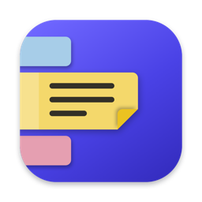
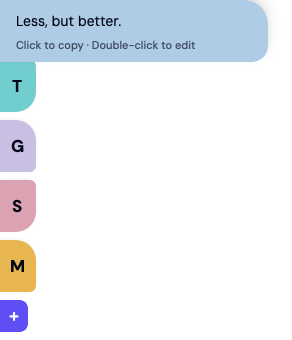
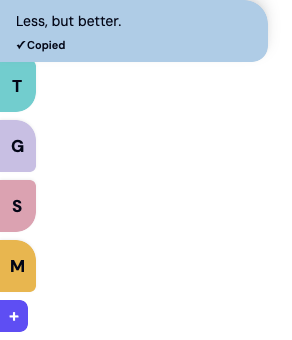
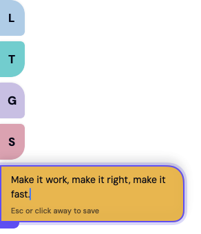
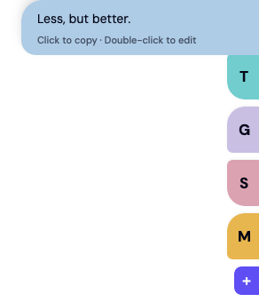

<p align="center">
  
</p>

<h1 align="center">StickySideNote</h1>

<p align="center">
  <b>Sticky notes that live on the edge of your Mac's screen.</b><br>
  Always in sight, never in the way. Hover to read, click to copy.
</p>

<p align="center">
  
  
  
</p>

<p align="center">
  
  &nbsp;&nbsp;&nbsp;
  
</p>

## Why

You know the paper sticky notes people put on the bezel of their monitor: a quote, a command they
keep forgetting, the thing to remember this week. StickySideNote is that, on the screen itself.

Other note apps either float in the middle of your work or hide in a drawer until you summon them.
These stay put as slim coloured tabs on the edge, one glance away, and each one is a single click
from your clipboard.

## What it does

| | |
|---|---|
| **Always visible** | Notes sit as small tabs on the left or right edge, above your other windows. Each tab shows the note's first character. |
| **Hover to read** | Move the pointer over a tab and the note slides out. Move away and it tucks back in. |
| **Click to copy** | One click puts the whole note on the clipboard. No selecting, no shortcuts. |
| **Edit in place** | Double-click to edit right there. Esc or a click elsewhere saves. |
| **Six colours** | Right-click a note to recolour or delete it. |
| **Any screen, either side** | Drag the rail to another display. It snaps magnetically to the nearest left or right edge. |
| **Clipboard to note** | Copied something elsewhere? One menu item turns the clipboard into a new note. |
| **Stays out of your way** | Never steals keyboard focus, lets clicks through everywhere outside the tabs, and hides while another app is in full screen. |

<p align="center">
  
  &nbsp;&nbsp;&nbsp;
  
</p>
<p align="center"><sub>Editing in place · The rail mirrored on the right edge</sub></p>

## Install

StickySideNote is built from source. You need macOS 14 or later and Xcode (for the Swift 6 toolchain).

```bash
git clone https://github.com/0XFF-96/StickySideNote.git
cd StickySideNote
bash scripts/install.sh
```

The script builds a release binary, assembles `StickySideNote.app`, installs it to `/Applications`
and starts it. The app is ad-hoc signed and is not notarised, so it is meant for your own machine.

It runs as a menu bar app: no Dock icon, no main window. Launch at login is on by default and can
be turned off from the menu.

## Using it

| Do this | To |
|---|---|
| Hover a tab | Read the whole note |
| Click a note | Copy it |
| Double-click a note | Edit it (Esc or click away to save; saving it empty deletes it) |
| Right-click a note | Change colour, or delete |
| Click **+** | Add a note |
| Drag any tab | Move the rail to another screen or side |

The menu bar icon adds a note (blank or from the clipboard), moves the rail to a side of any
screen, hides or shows all notes, toggles launch at login, and quits.

The interface is in English or Simplified Chinese, following your system language. Notes
themselves can be in any language.

## Your notes

Notes are plain text in one JSON file on your Mac:

```
~/Library/Application Support/StickySideNote/notes.json
```

Nothing is synced or sent anywhere. Every keystroke is saved as you type, writes are atomic, and a
file that cannot be read is set aside as a backup rather than overwritten.

## How it is built

- **`StickyCore`** holds everything that can be tested without a screen: the note model, storage,
  the layout maths (how tabs shrink to fit, where the rail lands when dropped) and the interaction
  state machine. It has no UI dependencies.
- **`StickySideNote`** is the app: a borderless, non-activating `NSPanel` hosting SwiftUI views.
  The panel is only as large as what is showing, which is what keeps the rest of the screen
  clickable. Mouse handling goes through a thin AppKit layer, because hover and click need to work
  while another app has focus.

No third-party dependencies.

```bash
swift test                 # unit tests for StickyCore
bash scripts/make-icon.sh  # redraw the icon and rebuild Resources/AppIcon.icns
```

To check the look without screen-recording permission, the app can render its own states to PNG
(this is how the images above were made). It uses a separate `notes.json` in that folder and quits:

```bash
STICKY_SNAPSHOT_DIR=/tmp/snap /Applications/StickySideNote.app/Contents/MacOS/StickySideNote
```

The design notes are in [`docs/superpowers/specs`](docs/superpowers/specs).

## Not yet

Things deliberately left out of this first version:

- Sync between Macs
- Images, rich text or Markdown
- Reordering notes by dragging
- A rail on the top or bottom edge
- A global keyboard shortcut

## Uninstall

1. Turn off "Launch at login" in the menu bar menu, then choose "Quit".
2. Delete `/Applications/StickySideNote.app`.
3. Delete `~/Library/Application Support/StickySideNote/` to remove your notes.
